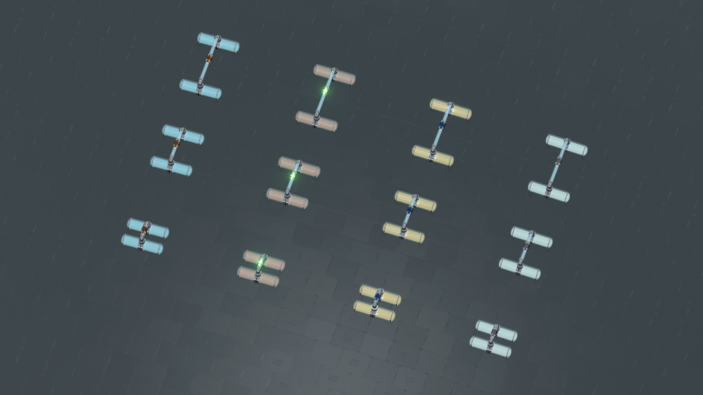

# Fluid Pipes

戴森球计划的管道基础库，提供共享库存、连接拓扑、原生建造交互和程序化渲染。Mod 可以注册自己的管道物品、连接结构和外观，也可以直接使用内置的玻璃管道与阀门。


## 能做什么

- **共享库存**：无向管网内立即共享同一种物品，每段管道提供 10 单位容量；储液罐和物流塔槽位可以接入同一空间。
- **建造与交互**：拖拽铺设、升降、任意角度分支、碰撞检查、库存面板和连接管理。
- **运输控制**：分拣器与原生输送口存取库存；阀门控制方向、速率和目标液位，沙盒模式支持永续供给与回收。
- **扩展类型**：独立物品与配方、连接家族、有向结构、拓扑查询和变更通知。
- **扩展外观**：管径、截面、材质、纹理坐标和动态光效；渲染器负责网格缓存、分区与细节层级。



[游戏内图库](docs/GALLERY.md)展示不同流体的正多面体、单格边长为 3 的立体网格，以及液体分拣器的长度、等级、机壳与高差细节。

## 安装与使用

需要 BepInEx 5、CommonAPI、LDBTool 和 DSPModSave。构建或解压插件包，将 `FluidPipes.dll` 放到 profile 的 `BepInEx/plugins/FluidPipes/`，同一 profile 只保留一份 DLL。

内置管道和阀门随储液罐的“流体储存封装”科技解锁，在建造栏的可用空位中出现。手持管道拖拽铺设，点击已建成的管段可查看、存取共享库存和断开连接。管道通过分拣器与普通传送带交换物品。阀门保持两侧空间独立，正常泵送需要约 100 kW 电力。

默认只运输流体。配置文件为 `BepInEx/config/com.komonad.dsp.fluidpipes.cfg`，修改后重启游戏：

| 配置项 | 默认值 | 用途 |
| --- | --- | --- |
| `Integration.EnableMachinePorts` | `false` | 直接连接生产机器的分拣器插槽 |
| `Transport.IncludeFluids` | `true` | 允许流体物品 |
| `Transport.AllowedItemIds` | 空 | 额外允许的物品 ID |
| `Transport.DeniedItemIds` | 空 | 禁止的物品 ID，优先于其它准入规则 |

原生储液罐只接受流体。更改准入规则会保留既有库存，并允许继续取出。机器直连启用后，在相连管段的“机器直连接口设置”中选择供料或提取的配方物品。完整选项和星环无尽水罐适配见[配置说明](docs/CONFIGURATION.md)。

## 接入其它 Mod

目标框架为 .NET Framework 4.7.2。引用 `FluidPipes.dll`，设置 `Private=false`；将同目录的 `FluidPipes.xml` 放在 DLL 旁可获得 IDE 文档。插件依赖使用编译时引用的库版本：

```csharp
using BepInEx;
using FluidPipes.API;

[BepInDependency(PipeApi.PluginGuid, PipeApi.ModVersion)]
```

公开接口位于 `FluidPipes.API`：

| 入口 | 用途 |
| --- | --- |
| `PipeApi` | 物品准入、共享库存查询与存取、阀门和机器接口配置 |
| `PipeTypes` | 类型注册、连接拓扑和变更通知 |
| `PipeTypeDefinition`、`PipeAppearance` | 模拟行为、建造方式、几何与外观定义 |
| `PipeRendering` | 为扩展附件提供共享金属反射参数 |

物品准入可在插件的 `Awake` 中注册；工厂操作需等待 `PipeApi.IsReady`，并使用有效的工厂和实体 ID。返回的库存是快照，存取操作需要在 Unity 主线程或独占的工厂模拟上下文中执行。

- [API 接入](docs/API.md)：生命周期、库存语义、存取、线程与失败行为。
- [管道类型与外观](docs/PIPE_TYPES.md)：注册自有物品、共享管道和外部模拟结构。自有物品体系可在 `Awake` 中调用 `PipeApi.DisableBuiltInItems()` 关闭内置内容。
- [PipeConsumer](examples/PipeConsumer/ConsumerPlugin.cs)：可编译的物品准入与有界存取示例。
- [CopperPipes](examples/CopperPipes/README.md)：可编译的独立管道、配方与材质扩展。

## 开发

将 `Local.props.example` 复制为 `Local.props`，填写游戏程序集与 BepInEx 路径后构建：

```powershell
dotnet build FluidPipes.csproj -c Release
```

构建、验证和打包步骤见[开发指南](docs/DEVELOPMENT.md)。内部设计见[架构](docs/ARCHITECTURE.md)和[渲染](docs/RENDERING.md)；游戏内检查见[测试说明](TESTING.md)，基准负载和测量边界见[性能测量](tests/PERFORMANCE.md)。
