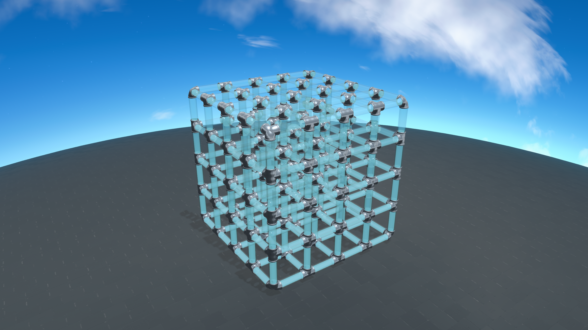
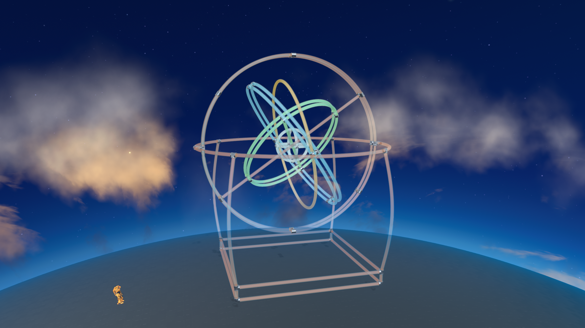
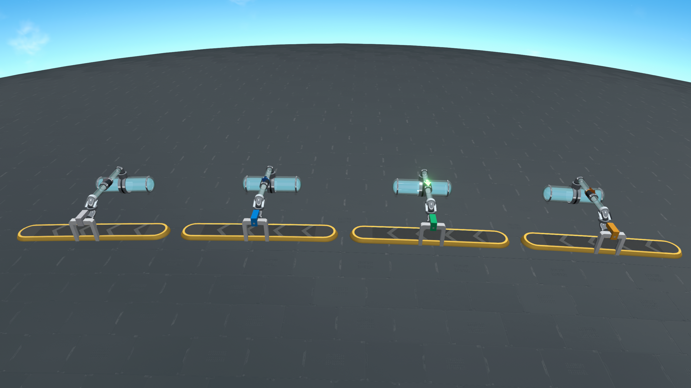
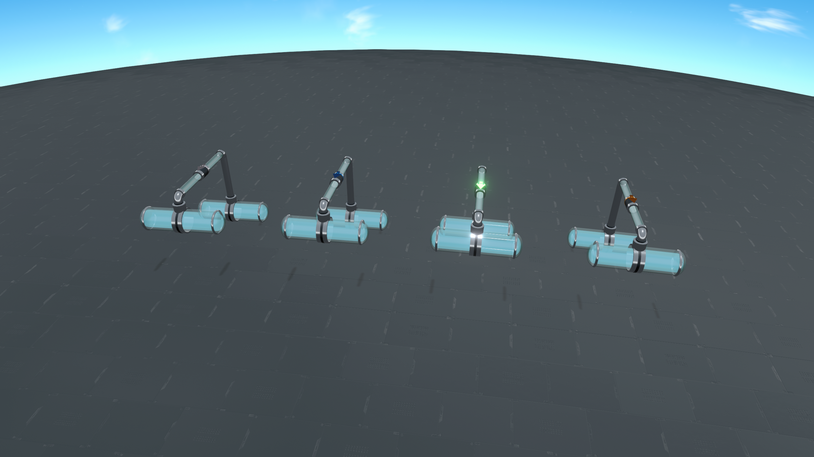

# 游戏内图库

场景使用内置玻璃管道和真实原生分拣器，通过游戏相机及插件渲染器生成 2560×1440 截图。流体颜色沿用原生储液罐调色板。

## 玻璃管正多面体

五件几何体各自构成独立的共享库存管网。

| 正多面体 | 边长 | 流体 |
| --- | ---: | --- |
| 四面体 | 8 | 精炼油 |
| 立方体 | 7 | 水 |
| 八面体 | 7 | 原油 |
| 十二面体 | 6 | 硫酸 |
| 二十面体 | 7 | 重氢 |

边长以 Unity 世界单位计。顶点与沿边采样点位于每件几何体的局部正交坐标系中。


## 立体网格

网格包含 4×4×4 个立方单元，每格边长为 3，整体边长为 12。125 个交点与 300 条格边由 725 个管道节点和 900 段连接构成；六向交汇与全部边共享同一份水库存。



## 流体浑天仪与双螺旋塔

浑仪由方形双层底座、四柱支架、水平地平环、子午双环、倾斜极轴、赤道双环、黄道环、四游双环、窥管与中心球形骨架组成。1654 个节点与 1688 条边形成五组独立管路。极轴仰角为 35°；赤道环与极轴垂直，黄道环相对赤道环倾斜 23.4°。

环架与支撑关系参考[格林尼治皇家博物馆藏浑仪](https://www.rmg.co.uk/collections/objects/rmgc-object-10785)；本场景是固定的管道造型。




双螺旋塔的两条管路分别装有水与重氢，半径为 6.4，上升 42 世界单位并旋转三圈。三个硫酸水平环分别位于底部、中部与顶部，730 个节点组成五条独立管路。


[原生蓝图与配色说明](../blueprints/README.md)包含浑仪、双螺旋塔与立体网格的可导入文本。完整连接图随蓝图保存，建成后需要单独注入流体。验证覆盖多分叉、环路、选区裁剪、待建复制、重复盖建、实际建造及存档冷启动重载，并逐边比较拓扑。

## 液体分拣器

阵列从左到右为分拣器、高速分拣器、极速分拣器和集装分拣器；每种等级展示 1、2、3 三种跨度。玻璃臂、金属弯管、端点管箍与等级箭头随实际端点位置生成。


连接普通传送带的分拣器保留原生等级机壳；管道侧使用贴合管壁的鞍座。下图展示四种等级的传送带端与管道端。




高差连接保持同轴的端点管箍与连续的玻璃臂。



## 生成场景

按[开发指南](DEVELOPMENT.md)配置本机环境，退出当前游戏，在仓库根目录运行：

```powershell
pwsh -NoProfile -File tests/capture-scene.ps1 -SolidsGallery
pwsh -NoProfile -File tests/capture-scene.ps1 -InserterGallery
pwsh -NoProfile -File tests/capture-scene.ps1 -WondersGallery
```

命令分别启动隔离的后台沙盒。完整 PNG 截图和检查报告写入 `screenshots/showcase/`，奇观蓝图同时写入其 `blueprints/` 子目录。几何体检查连接度数、单一流体身份、容量和远端提取守恒；分拣器检查原生组件、端点角色、显示归属、库存隔离与供电标记。奇观场景调整隔离星球的自转相位，使用原生光照拍摄白天和黄昏视图。
