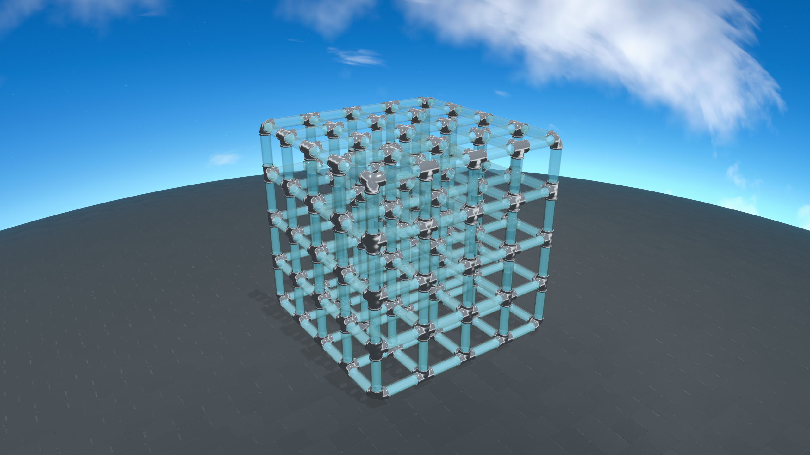
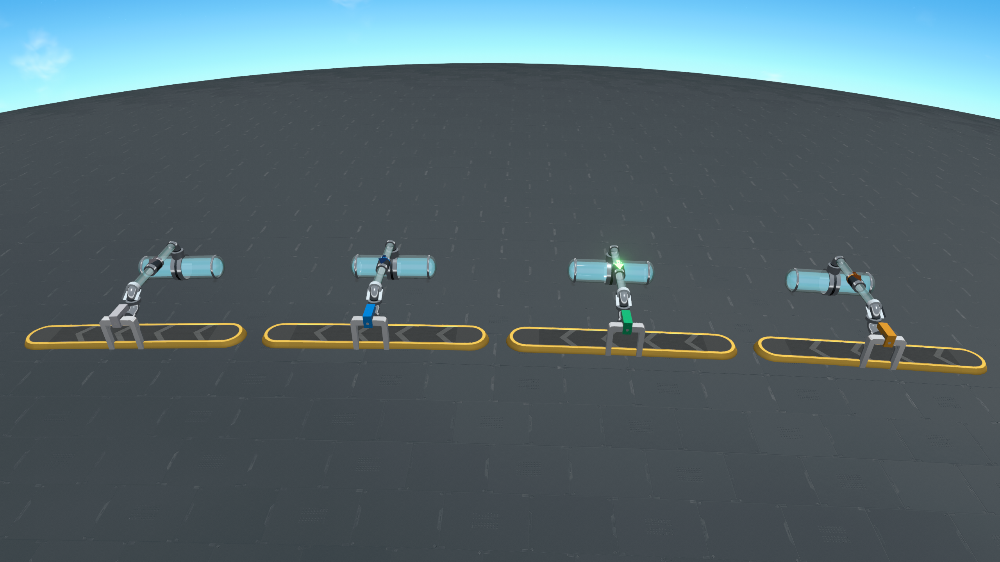
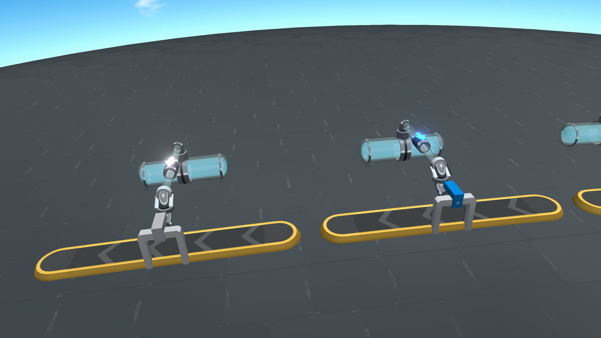
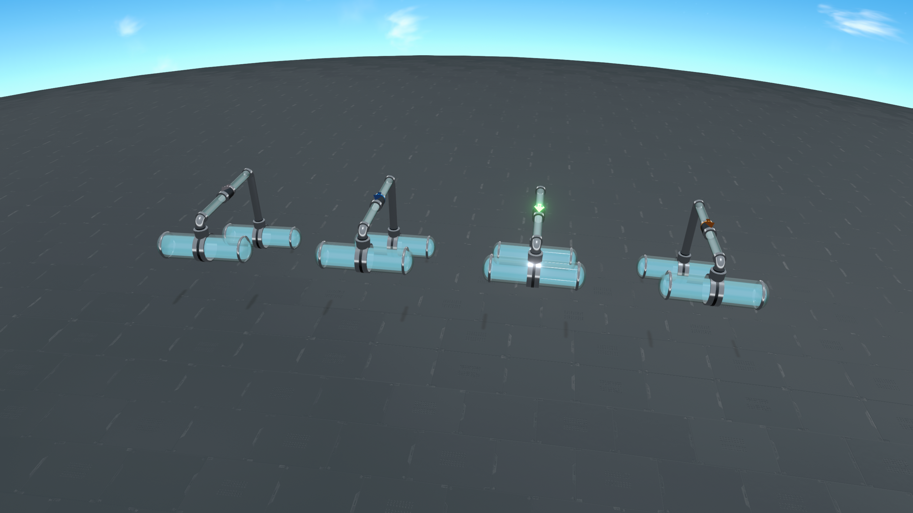

# 游戏内图库

场景使用内置玻璃管道和真实原生分拣器，通过游戏相机及插件渲染器生成 2560×1440 截图。流体颜色沿用原生储液罐调色板。

## 玻璃管正多面体

五件几何体各自构成独立的共享库存管网。

| 正多面体 | 边长 | 流体 |
| --- | ---: | --- |
| 四面体 | 8 | 精炼油 |
| 立方体 | 7 | 水 |
| 八面体 | 7 | 原油 |
| 十二面体 | 6 | 硫酸 |
| 二十面体 | 7 | 重氢 |

边长以 Unity 世界单位计。顶点与沿边采样点位于每件几何体的局部正交坐标系中。


## 立体网格

网格包含 4×4×4 个立方单元，每格边长为 3，整体边长为 12。125 个交点与 300 条格边由 725 个管道节点和 900 段连接构成；六向交汇与全部边共享同一份水库存。



## 液体分拣器

阵列从左到右为分拣器、高速分拣器、极速分拣器和集装分拣器；每种等级展示 1、2、3 三种跨度。玻璃臂、金属弯管、端点管箍与等级箭头随实际端点位置生成。


连接普通传送带的分拣器保留原生等级机壳；管道侧使用贴合管壁的鞍座。下图展示四种等级的传送带端与管道端。





高差连接保持同轴的端点管箍与连续的玻璃臂。



## 生成场景

按[开发指南](DEVELOPMENT.md)配置本机环境，退出当前游戏，在仓库根目录运行：

```powershell
pwsh -NoProfile -File tests/capture-scene.ps1 -SolidsGallery
pwsh -NoProfile -File tests/capture-scene.ps1 -InserterGallery
```

两项命令分别启动隔离的后台沙盒。完整 PNG 截图和检查报告写入 `screenshots/showcase/`。几何体检查连接度数、单一流体身份、容量和远端提取守恒；分拣器检查原生组件、端点角色、显示归属、库存隔离与供电标记。
